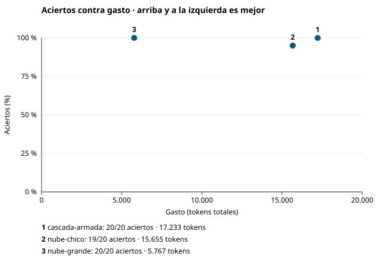

# Lab 1 · Decisión

## 1. Tabla de resultados
 Configuración | Aciertos | Inválidas | Tokens | Segundos | Costo estimado (USD) |
|---|---|---|---|---|---|
| cascada-armada | 20/20 | 0 | 17233 | 88.8 | 0.0 |
| nube-chico | 19/20 | 0 | 15655 | 67.8 | 0.0 |
| nube-grande | 20/20 | 0 | 5767 | 107.3 | 0.0 |

## 2. Gráfico

## 3. Casos importantes
- Reclamo R07: parece ser un caso donde se puede considerar un error tecnico. pero la categoria mas correct es reembolso_pendiente

## 4. Regla de ruteo de modelos
| Tarea | Modelo o configuración | Por qué se elige | Riesgo y privacidad | Cuándo escalar |
|categorizar reclamos|liquid/lfm-3-1.7b:free|usa menos tokens con alto porcentage de acierto|---|cuando la confianza es baja|

## 5. Lo que el chequeo no verifica
en el caso que se equivovo la confianze era baja